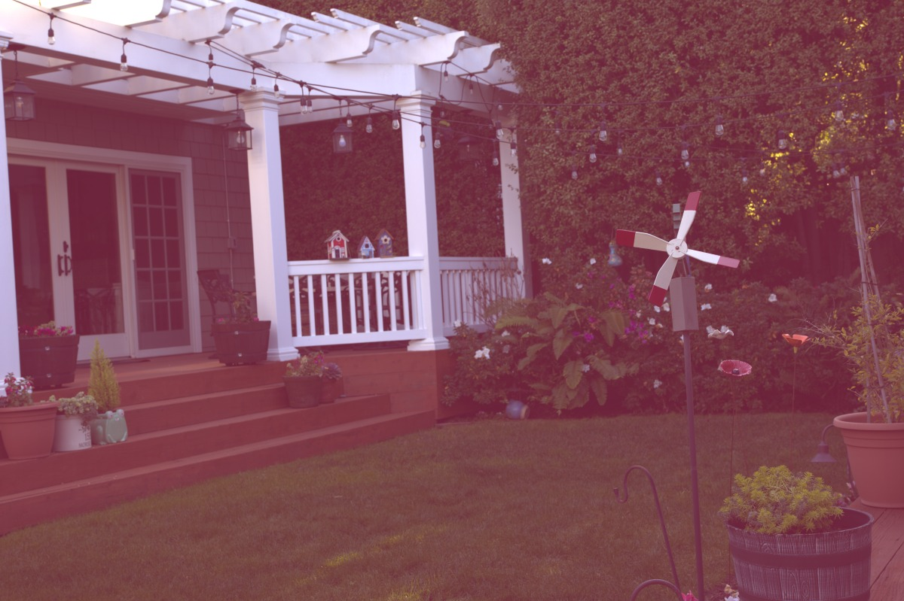

# Canon CR3 Native WIC Codec (Windows 10/11 x64)

Native **Windows Imaging Component (WIC)** decoder for Canon `.CR3` RAW files, powered by current **LibRaw** with **OpenMP**.
Makes Windows Explorer (thumbnails, preview pane & EXIF/GPS details), Paint, and classic WIC viewers render **true 14-bit RAW colors** without the magenta/pink tint of outdated Microsoft codecs.

- **True RAW Colors & Speed:** Full 14-bit demosaicing with OpenMP acceleration, fast previews (`GetPreview`), scaled decoding (`IWICBitmapSourceTransform`), and a 4× 64 KB LRU stream cache for network shares and SD cards.
- **Explorer Metadata & Tuning:** Exposes camera/lens EXIF, GPS, and ratings in Windows Details; optional Registry tuning for 16-bit (`48bppBGR`), wide-gamut color spaces, or embedded JPEG thumbnails (see [Wiki](https://github.com/felix-henry/windows-cr3-raw-codec/wiki)).

---

## Visual Comparison (Canon EOS R6 Mark III)

| Microsoft Raw Image Decoder (Before) | Canon CR3 WIC Codec (After) |
| :---: | :---: |
|  |  |
| *Outdated color matrix / black level → strong magenta wash* | *Current LibRaw 14-bit RAW demosaicing & camera WB* |

Sample RAW: [Canon EOS R6 Mark III (.CR3, CC0 Public Domain)](docs/images/canon-eos-r6-mark-iii-sample.CR3) via [raw.pixls.us](https://raw.pixls.us/)

---

## Download & Install

**[Download Latest Release](https://github.com/felix-henry/windows-cr3-raw-codec/releases/latest)** *(Windows 10 / 11 64-bit)*

1. **Setup Installer (`CR3WICCodec-Setup-x64-v*.exe`):** Run the setup wizard. Uninstall anytime via **Windows Settings → Apps**.
2. **Portable ZIP (`CR3WICCodec-x64-portable.zip`):** Extract and double-click **`Install.exe`** (uses UAC elevation, no PowerShell needed). Double-click **`Uninstall.exe`** to remove.
3. **Updating:** Re-run the latest `Setup.exe` / `Install.exe` over an existing install, or run `powershell -NoProfile -ExecutionPolicy Bypass -File "C:\Program Files\CR3WICCodec\scripts\update.ps1" -FromGitHub` in an Administrator PowerShell (verifies `SHA256SUMS.txt` automatically).

**Requirements:** Windows 10 (1809+) / Windows 11 (x64) and [VC++ 2015–2022 Redistributable (x64)](https://aka.ms/vs/17/release/vc_redist.x64.exe).

---

## Supported Cameras

Supports **all Canon `.CR3` cameras** supported by LibRaw, including:
- **EOS R series:** EOS R, RP, R1, R3, R5, R5 C, R5 Mark II, R6, R6 Mark II, **R6 Mark III**, R7, R8, R10, R50, R100
- **DSLR / EOS M / PowerShot:** EOS 90D, 250D, 1D X Mark III, M50 / M50 II, M6 II, PowerShot G5 X II / G7 X III / V1

---

## Documentation

- **[Wiki — Technical Guide, Build Instructions, Registry Tuning & Troubleshooting](https://github.com/felix-henry/windows-cr3-raw-codec/wiki)**

---

**Built for Canon photographers on Windows 10 / 11** · **[felixhenry.de](https://felixhenry.de)**

[MIT License](LICENSE) · Powered by [LibRaw](https://www.libraw.org/) (LGPL 2.1 / CDDL 1.0) · [Third-Party Notices](THIRD_PARTY_NOTICES.md)

